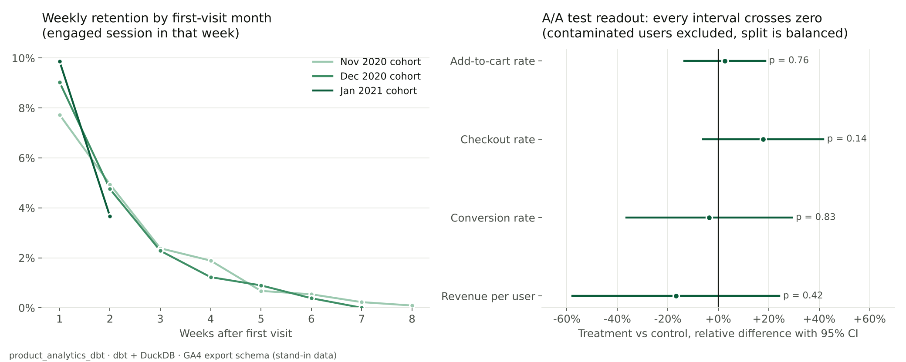

# Product analytics on GA4 events (dbt)

A dbt project that turns a raw Google Analytics 4 event export into the numbers a product team
runs on: sessions, people, active users, activation, weekly retention, feature adoption, revenue,
and an experiment readout you can trust.

It is built on the GA4 BigQuery export schema (the Google Merchandise Store sample), and it handles
the parts that usually go wrong quietly: devices that are really one person, events that arrive days
late, purchases that fire twice, sessions that cross midnight, and users who end up in both arms of
a test.



## What's in it

| Layer | Models | Notes |
|---|---|---|
| Staging | `base_ga4__events` (incremental), `stg_ga4__events`, `stg_experiments__exposures` | Dedupes events, computes arrival time, flags late events |
| Intermediate | `int_identity_map`, `int_events__stitched`, `int_sessions` | Devices → people; sessions keyed on `ga_session_id`, GA4's engaged-session rules |
| Product marts | `fct_sessions`, `fct_orders`, `dim_users`, `fct_user_daily_activity`, `fct_retention_weekly`, `fct_feature_adoption_weekly`, `rpt_activation_candidates` | One clear grain per table, written at the top of each file |
| Experiment marts | `fct_experiment_assignments`, `rpt_experiment_readout` | Contamination handling, fixed outcome window, SRM check, z-tests in SQL |
| Semantic layer | 12 MetricFlow metrics | Active users (DAU/WAU/MAU), engagement rate, activation rate, conversion, revenue... |

**4 unit tests and 44 data tests** run on every build, including:

- anonymous browsing is credited to the person who later logs in, and two devices with the same login become one person
- GA4's engaged-session rules, and a session crossing midnight staying one session
- users seen in both arms of a test are excluded, and outcomes only count inside the 14-day window
- order revenue reconciles to the first purchase event of each transaction
- every event lands in exactly one session
- the hand-written normal CDF behind every p-value matches published values
- the A/A test never shows a significant result or a sample ratio mismatch

## The parts that usually go wrong

| Problem in GA4 data | How it's handled |
|---|---|
| `user_pseudo_id` is a browser, not a person | Identity stitching: once a device logs in, all its events, including the anonymous ones before login, belong to that person |
| Events arrive up to 72 hours late | Incremental model filters on **arrival** time, not event time, and reprocesses 3 days of arrivals each run |
| Exact duplicate events | Hashed event key, first arrival kept (368 removed) |
| `purchase` fires again when the confirmation page reloads | One row per transaction; repeats counted, not summed |
| Sessions crossing midnight | Keyed on `ga_session_id`, not `event_date` |
| "Active" that includes bounces | Active = engaged session, GA4's own definition, so it matches the GA4 UI |
| Newest cohorts look worse because their window isn't over | Activation and retention flag incomplete windows instead of counting them as zero |
| Users in both arms of a test | Excluded from the primary readout, with a sensitivity check that keeps them |

**How I chose the activation event:** `rpt_activation_candidates` scores five candidates on reach, lift
in 30-day purchase rate, and the share of future buyers they catch. Add-to-cart within 7 days catches
88% of buyers while still being early enough for a product team to influence.

The reasoning behind every definition is in **[docs/metric_definitions.md](docs/metric_definitions.md)**.

## Proving the late-arriving logic

`make incremental` builds the warehouse twice: as two incremental runs (everything that had arrived
by 20 Jan, then the rest) and as one full refresh. Every mart has to match exactly.

```
events that happened before the cutoff but arrived after it: 13
PASS  product.fct_sessions                     rows only in incremental: 0, only in full refresh: 0
PASS  product.fct_orders                       rows only in incremental: 0, only in full refresh: 0
PASS  product.dim_users                        rows only in incremental: 0, only in full refresh: 0
PASS  product.fct_retention_weekly             rows only in incremental: 0, only in full refresh: 0
PASS  product.fct_feature_adoption_weekly      rows only in incremental: 0, only in full refresh: 0
PASS  experiments.rpt_experiment_readout       rows only in incremental: 0, only in full refresh: 0
```

## Experiments: why an A/A test

The public GA4 data has no experiments in it, so the project layers an **A/A test** on the traffic
(`scripts/simulate_aa_assignment.py`): both arms get the same experience, users are bucketed by a hash
of their device id, exposures are logged on every product-page load, and a simulated caching bug puts
2% of users in both arms. The true effect is zero by construction, which turns the readout into a test
of the pipeline itself. If it ever says "significant", the bucketing, exposure logic or stats are broken.

## Built for people and for AI

Metrics live in the dbt Semantic Layer with descriptions that say what is counted, on which date and
what is excluded, so an AI tool querying them gets the same answer as an analyst.
`evals/golden_questions.yml` holds real questions ("How many weekly active users did we have in the
week of 7 December?"), each answered through the semantic layer **and** in plain SQL.
`make questions` fails if they disagree.

```
PASS  wau_week_of_7_dec_2020        How many weekly active users did we have in the week of 7 December 2020?
PASS  activation_rate_nov_2020      What share of people who first visited in November 2020 activated?
PASS  revenue_dec_2020              What was revenue in December 2020?
PASS  organic_conversion_dec_2020   What was the session conversion rate from organic search in December 2020?
PASS  mobile_engagement_jan_2021    What was the engagement rate on mobile in January 2021?
PASS  new_users_dec_2020            How many new users did we get in December 2020?
6/6 golden questions agree
```

## The data

`data/raw/ga4_events.csv.gz` is a **stand-in dataset** with exactly the columns that
`scripts/export_ga4_sample.sql` produces from Google's public GA4 Merchandise Store sample
(`bigquery-public-data.ga4_obfuscated_sample_ecommerce`, Nov 2020 to Jan 2021): about 96k events from
6,800 devices, with the same quirks as the real export, including no logged-in users and Google's
`(data deleted)` sources. It is generated by `scripts/generate_standin_events.py` so the project builds
anywhere without a Google Cloud account.

To run on the real data: run `scripts/export_ga4_sample.sql` in BigQuery (free tier), save the result as
`data/raw/ga4_events.csv.gz`, then `python scripts/simulate_aa_assignment.py && make build`.
Nothing else changes.

## Run it

```bash
python -m venv .venv && source .venv/bin/activate
make setup        # dbt-duckdb, MetricFlow, duckdb
make build        # load raw data, build 17 models, run 4 unit tests + 44 data tests
make incremental  # prove incremental == full refresh with late-arriving events
make questions    # validate the semantic layer against the golden questions
```

Query a metric directly:

```bash
export DBT_PROFILES_DIR=.
mf query --metrics active_users,engagement_rate,revenue_usd --group-by metric_time__week
```

The SQL is written for DuckDB (`qualify`, `arg_min`, `make_timestamp`); moving to BigQuery means
swapping those for their BigQuery equivalents in about half a dozen places.

## Project layout

```
models/
  staging/          GA4 events (incremental, deduped) and experiment exposures
  intermediate/     identity map, stitched events, sessions (+ unit tests)
  marts/product/    sessions, orders, users, activity, retention, adoption, activation candidates
  marts/experiments assignments and readout (+ unit test)
  semantic/         semantic models and metrics
tests/              reconciliation and stats tests
macros/             normal CDF, channel grouping, date spine, generic tests
evals/              golden questions for the semantic layer
scripts/            BigQuery export query, stand-in generator, A/A assignment, loader, checks, chart
docs/               metric definitions and decisions
```

---

Faith Onyinye Igwe · [faithoigwe.github.io](https://faithoigwe.github.io)
