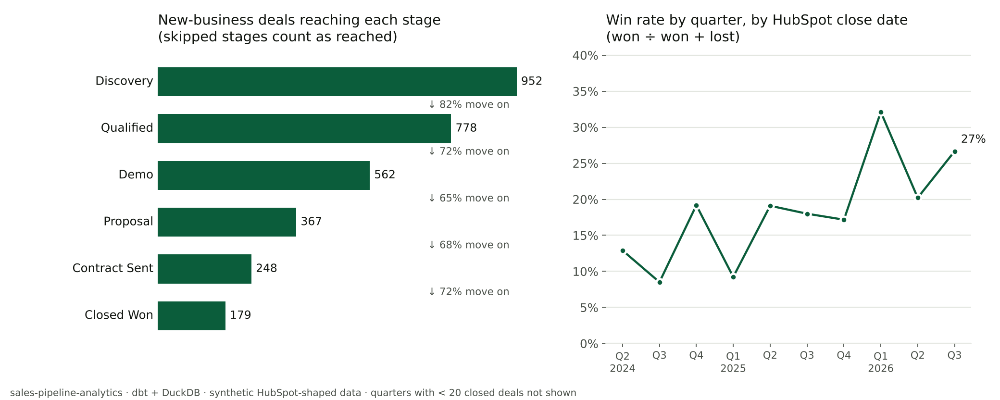

# Sales pipeline analytics (dbt)

A dbt project that turns HubSpot CRM data into sales numbers people can trust: pipeline,
deal velocity, stage conversion, win rates and the sales-led funnel. It also models
**creator commerce** (what creators sell and earn through the platform) and joins the two,
so you can ask whether the creators Sales closes actually go on to earn.

The setting is a creator-focused SaaS company with both a self-serve and a sales-led motion.
The data is synthetic but shaped like a real Fivetran HubSpot export, and it is messy on
purpose, because CRM data always is.



## What's in it

| Layer | Models | Notes |
|---|---|---|
| Staging | 10 `stg_` views | Rename, type, dedupe connector re-syncs, drop test purchases |
| Intermediate | stage history, owner history, amount/close-date history, USD purchases | Built from HubSpot **property history**, not the current-state deals table |
| Sales marts | `fct_deals`, `fct_deal_stage_transitions`, `fct_stage_reached`, `fct_pipeline_daily` (incremental), `fct_lead_funnel`, dims | One clear grain per table, written at the top of each file |
| Commerce marts | `fct_commerce_orders`, `fct_creator_commerce_monthly`, `dim_creators` | Multi-currency to USD, refunds handled two ways on purpose |
| Cross-domain | `rpt_won_deal_creator_earnings` | What a creator sold in their first 90 / 180 days after we closed them |
| Semantic layer | 24 MetricFlow metrics in `models/semantic/` | Win rate, bookings, sales cycle, open pipeline, funnel rates, creator net sales... |
| Snapshot | `snap_hubspot_deals` | SCD2 safety net for properties HubSpot doesn't keep history for |

**84 tests run on every build**: generic tests, custom tests (no overlapping history
windows, non-negative amounts, expression checks) and four reconciliation tests, for example:

- the rebuilt daily pipeline for the last day matches today's open deals exactly, deal by deal
- the current stage in the deals table matches the last stage in property history
- creator monthly net sales tie to order-level net sales to the cent
- every won deal has passed through every open stage

## The messy parts, and how they're handled

The generator (`scripts/generate_data.py`) plants the problems real HubSpot data has:

| Problem in the source | How the models deal with it |
|---|---|
| The deals table only holds current state | Pipeline-on-a-date, time-in-stage and owner-at-the-time all come from property history |
| Deals skip stages (~12%) or move backwards (~8%) | `transition_type` on every stage visit; a deal that skipped Demo still counts as reaching Demo, so the funnel adds up |
| Reps backdate close dates, sometimes days after closing (64 deals, 18 change month) | Bookings and win rate use HubSpot close date (it's what Sales reports on), sales cycle uses the real close time, and every mismatch is flagged |
| A rep leaves and their deals are bulk-reassigned | Original owner, current owner and owner-at-stage-entry are all kept, for different questions |
| Duplicate history rows from connector re-syncs (123) | Deduped in staging |
| Blank amounts on early deals, amounts revised at proposal | Daily pipeline shows the amount as it was that day |
| Soft-deleted deals, failed / refunded / test purchases, EUR and GBP sales | Filtered or converted once, upstream, so no dashboard can get it wrong |

The reasoning behind every definition is in **[docs/metric_definitions.md](docs/metric_definitions.md)**:
the options, the trade-offs and the open questions I'd take to Sales and RevOps.
How each HubSpot object flows through the project is in **[docs/hubspot_data_map.md](docs/hubspot_data_map.md)**.

## Built for people and for AI

Teams increasingly ask an AI tool connected to the semantic layer instead of asking the data team.
That only works if the definitions are clear enough for an agent to use without a human in the loop. So:

- metric and column descriptions say what is counted, which date it's reported on and what's excluded
  (for example: *"open pipeline is the last day of the period, never a sum across days"*)
- `evals/golden_questions.yml` holds real questions ("What was our new-business win rate in 2025?")
  with the semantic-layer query an agent should produce **and** an independent SQL answer
- `scripts/check_golden_questions.py` runs both and fails if they disagree

```
PASS  win_rate_2025                     What was our new-business win rate in 2025?
PASS  bookings_q3_2026                  How much new business did we book in Q3 2026?
PASS  sales_cycle_2026                  How long does it take us to close a new-business deal this year?
PASS  open_pipeline_end_of_june_2026    What was open new-business pipeline at the end of June 2026?
PASS  creator_net_sales_sales_led_2026  How much did sales-led creators earn selling products in 2026?
PASS  refund_rate_2025                  What share of creator sales was refunded in 2025?
6/6 golden questions agree
```

When a definition changes, this is what shows which answers moved.

## Run it

Everything runs locally on DuckDB, no warehouse or account needed. The SQL uses dbt's
cross-database macros (`dbt.datediff`, `dbt.date_trunc`, `dbt.dateadd`...) and the big
facts carry Redshift `sort` / `dist` configs, so the same models run on Redshift with the
target in `profiles.yml`.

```bash
python -m venv .venv && source .venv/bin/activate
make setup      # dbt-duckdb, MetricFlow, duckdb
make build      # dbt seed + dbt build: 29 models, 84 tests, 1 snapshot
make questions  # validate the semantic layer and run the golden questions
make docs       # browse lineage and column docs
```

Query a metric directly:

```bash
export DBT_PROFILES_DIR=.
mf query --metrics win_rate,bookings_usd,avg_sales_cycle_days \
  --group-by metric_time__quarter \
  --where "{{ Dimension('deal__deal_type') }} = 'New business'"
```

Useful starting queries for a pipeline review, rep-level stage conversion and sales-led
creator earnings are in `analyses/`.

## Project layout

```
models/
  staging/hubspot, staging/commerce   sources + one stg_ model per raw table
  intermediate/                       history → validity windows
  marts/sales, marts/commerce         facts and dimensions
  marts/utilities                     date dimension, MetricFlow time spine
  semantic/                           semantic models + metrics
snapshots/                            SCD2 snapshot of the deals table
tests/                                reconciliation tests
macros/                               date spine, schema naming, custom generic tests
evals/                                golden questions for the semantic layer
scripts/                              data generator, golden-question checker, chart
docs/                                 metric decisions, HubSpot data map
```

No dbt packages: the few macros I needed (date spine, generic tests) are in `macros/`,
so the project builds without network access.

## What I'd do next with real data

- Replace HubSpot's default stage probabilities with observed stage-to-won rates for weighted pipeline
- Add an exposure for each dashboard so changes show their downstream impact in CI
- Model product usage (feature adoption by sales-led vs self-serve creators) next to commerce
- Source-freshness alerts routed to the RevOps channel, not just CI

---

Faith Onyinye Igwe · [faithoigwe.github.io](https://faithoigwe.github.io)
