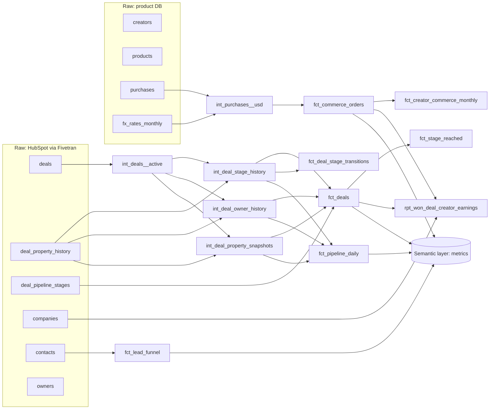

# How HubSpot data flows into the models

| HubSpot object | Raw table (Fivetran shape) | Staging | Used in |
|---|---|---|---|
| Deals (current state) | `deals` | `stg_hubspot__deals` | `int_deals__active` → everything |
| Deal property history | `deal_property_history` | `stg_hubspot__deal_property_history` | stage, owner, amount and close-date history |
| Pipelines and stages | `deal_pipeline_stages` | `stg_hubspot__deal_pipeline_stages` | `dim_deal_stages` |
| Companies | `companies` | `stg_hubspot__companies` | `dim_companies`, link to commerce via `creator_account_id` |
| Contacts | `contacts` | `stg_hubspot__contacts` | `fct_lead_funnel` |
| Owners | `owners` | `stg_hubspot__owners` | `dim_owners` |

## Gaps and quirks found in the source

- **The deals table has no history.** It is overwritten on every sync. Anything time-based (pipeline on a past date, time in stage, who owned the deal when) has to come from property history.
- **Only four properties are history-tracked** here: stage, owner, amount, close date. Lead source and lost reason are current-state only, which is why `snapshots/snap_hubspot_deals.yml` exists as a safety net.
- **Duplicate history rows.** About 1.5% of history rows are exact duplicates from connector re-syncs (123 in this dataset). Removed in staging on deal + property + value + timestamp.
- **Skipped and repeated stages.** Deals jump stages and occasionally move backwards. Handled in `int_deal_stage_history` (`transition_type`) and `fct_stage_reached`.
- **Close dates are edited after closing.** See `docs/metric_definitions.md` §1.
- **Blank amounts.** About 15% of deals have no amount until they are qualified. `fct_pipeline_daily` shows them as null for those days rather than back-filling a number nobody had at the time.
- **Bulk owner changes.** When a rep left on 30 Sep 2025 their open deals were reassigned by import the next day (`change_source = 'IMPORT'`). Rep metrics should not read that as a sales event.
- **Soft deletes.** Deleted deals stay in the raw table with `is_deleted = true` and are removed in `int_deals__active` (15 here).
